<div align="center">

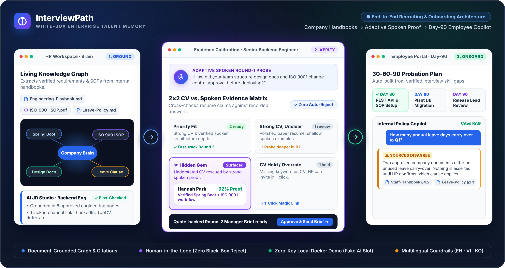

<br />

# InterviewPath

**White-box Talent Memory platform connecting company knowledge, adaptive spoken interviews, and Day-90 employee onboarding.**

[](./SpeakCV/src/backend)
[](./SpeakCV/src/frontend)
[](./interviewpath/interviewpath-demo)
[](./docker-compose.yml)
[](./Makefile)
[](#)

[**🎬 Product Demo Video**](#-product-walkthrough-video) · [**✨ Key Capabilities**](#-key-capabilities) · [**📸 Product Tour**](#-product-tour) · [**🏗️ Architecture**](#️-system-architecture) · [**🚀 Quick Start (Zero API Keys)**](#-quick-start-docker) · [**🧪 Evaluation Suite**](#-evaluation--verification-suite)

</div>

---

## Overview

Most hiring stacks treat recruitment as disconnected, disposable steps: JDs are copied from stale documents, keyword filters auto-reject strong engineers with concise resumes, interview notes vanish after the offer letter, and new hires spend weeks hunting down conflicting policy PDFs.

**InterviewPath** unifies these workflows around a single **Company Brain** — a versioned, document-grounded knowledge graph built from real internal handbooks, engineering playbooks, and SOPs:

- **Human-in-the-Loop by Design:** AI extracts requirements, conducts structured spoken Round-1 interviews, and cross-references evidence — **never auto-rejecting a candidate**. Every hiring gate, override, and onboarding plan stays under explicit HR & Hiring Manager control.
- **2×2 Evidence Calibration ("Hidden Gem" Discovery):** Combines paper CV screening with recorded, adaptive spoken answers so candidates with thin resumes but strong real-world engineering depth surface clearly instead of disappearing into a keyword filter.
- **Source-Cited & Contradiction-Aware RAG:** Every JD check, interview rubric, 30-60-90 day probation milestone, and employee policy answer cites its exact handbook clause — and explicitly warns `SOURCES DISAGREE` when two internal documents contradict each other.

---

## 🎬 Product Walkthrough Video

Click the preview below (or open [**`interviewpath_hr_recruitment_2m30s.mp4`**](./interviewpath/demo-video-2min/v4-hr-recruitment-2m30s/interviewpath_hr_recruitment_2m30s.mp4)) to watch the complete **2m 32s end-to-end product walkthrough** running against a live multi-container local stack:

<div align="center">
  <a href="./interviewpath/demo-video-2min/v4-hr-recruitment-2m30s/interviewpath_hr_recruitment_2m30s.mp4">
    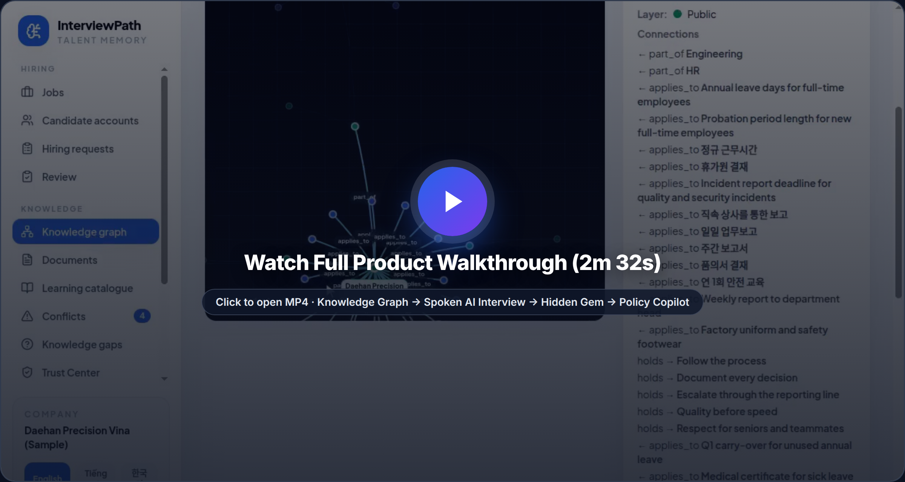
  </a>
  <p>
    ▶️ <a href="./interviewpath/demo-video-2min/v4-hr-recruitment-2m30s/interviewpath_hr_recruitment_2m30s.mp4"><strong>Watch Full Product Demo Video (MP4 · 2m 32s)</strong></a>
    &nbsp;·&nbsp;
    📄 <a href="./interviewpath/demo-video-2min/v4-hr-recruitment-2m30s/VOICEOVER_SCRIPT_EN.md"><strong>Timecoded Walkthrough Transcript</strong></a>
  </p>
</div>

| Timecode | Workflow Stage | What Happens in the Live App |
| :--- | :--- | :--- |
| **`00:02 – 00:34`** | **Company Brain, JD Studio & Channel Analytics** | Extracts nodes from handbooks & engineering docs; drafts a policy-checked *Senior Backend Engineer* JD; compares LinkedIn, TopCV, university & referral conversion quality. |
| **`00:34 – 01:04`** | **CV Screening, HR Override & Spoken AI Interview** | Screens incoming CVs; HR overrides a held resume with a **1-click Magic Link**; candidate tests mic, answers spoken technical prompts, and handles an adaptive ISO 9001 follow-up. |
| **`01:04 – 01:34`** | **2×2 Evidence Matrix & Round-2 Brief** | Cross-references CV fit vs. spoken evidence to surface a **Hidden Gem** candidate; generates a quote-backed Round-2 brief for the hiring manager. |
| **`01:34 – 02:00`** | **30-60-90 Day Probation Roadmap** | Converts verified interview skill gaps and team knowledge nodes into a tailored 30-60-90 day onboarding plan approved by HR in one click. |
| **`02:00 – 02:32`** | **Employee Onboarding & Conflict-Aware Copilot** | Newly hired probation employee tracks Day-30 milestones and asks the internal Policy Copilot about annual leave — receiving exact citations plus a `SOURCES DISAGREE` alert where documents conflict. |

---

## ✨ Key Capabilities

1. **Living Company Knowledge Graph (`HR Workspace`)**
   Ingests Markdown/PDF handbooks, engineering playbooks, and ISO procedures into typed knowledge nodes and edges with strict visibility boundaries (public, internal, manager-confidential) and human approval workflows.
2. **Graph-Grounded JD Studio & Discrimination Guard**
   Drafts structured job descriptions directly from hiring requests and approved knowledge nodes, running automated multilingual compliance checks (`EN` / `VI` / `KO`) before publication.
3. **Channel Conversion Attribution**
   Generates tracked application links per sourcing channel and measures downstream pass rates, interview completion, Hidden Gem yield, and cost-per-hire rather than vanity click counts.
4. **Human-in-the-Loop CV Board & 1-Click Magic Links**
   Auto-provisions candidate accounts upon application, flags borderline CVs for human inspection, and lets HR invite any held candidate into a Round-1 AI interview with a single click.
5. **Adaptive Spoken AI Interview & Fit Compass**
   Gives candidates a transparent pre-interview *Fit Compass*, records spoken responses in browser audio, transcribes turns, and asks targeted follow-up probes grounded in the role's actual engineering workflows.
6. **Day-90 Onboarding & Conflict-Safe Policy Copilot**
   Preserves hiring context after the offer: builds personalized 30-60-90 day checklists from verified interview gaps and answers employee policy questions strictly from authorized company documents.

---

## 📸 Product Tour

<table>
  <tr>
    <td width="50%" valign="top">
      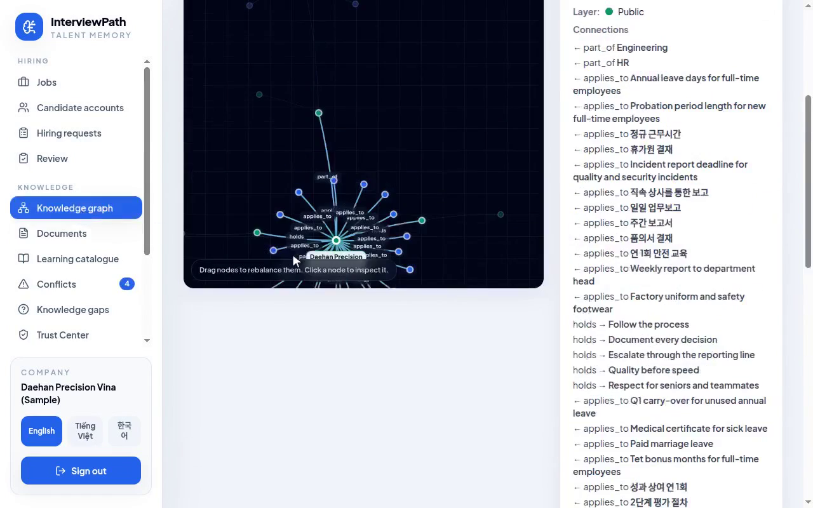
      <p align="center"><strong>1. Living Company Knowledge Graph</strong><br/><sub>Interactive force-directed graph linking policies, engineering standards, and role requirements back to source clauses.</sub></p>
    </td>
    <td width="50%" valign="top">
      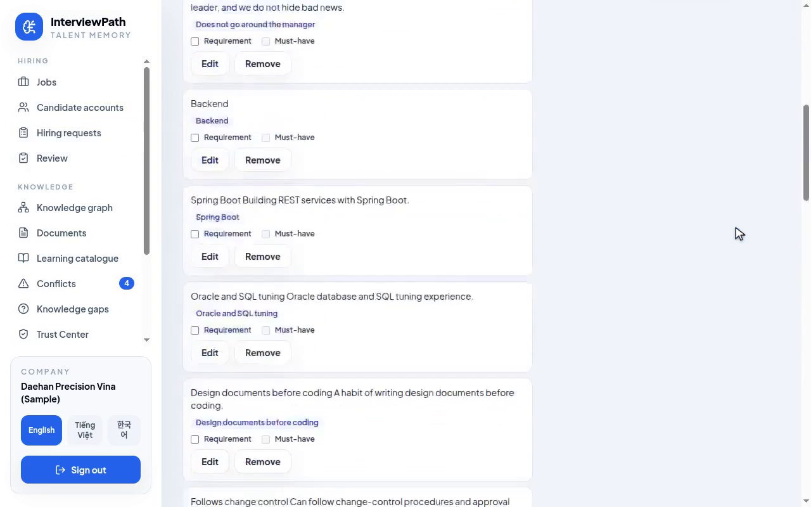
      <p align="center"><strong>2. Graph-Grounded JD Studio</strong><br/><sub>Drafts requirement cards from approved company nodes with built-in bias and policy checks.</sub></p>
    </td>
  </tr>
  <tr>
    <td width="50%" valign="top">
      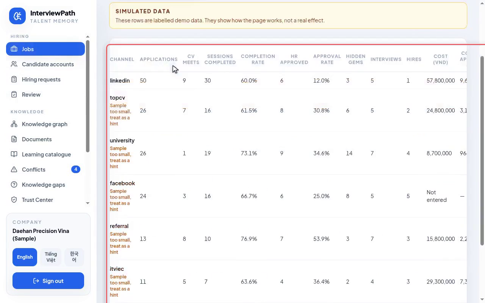
      <p align="center"><strong>3. Sourcing Channel Attribution</strong><br/><sub>Tracks funnel conversion, verified skill pass rates, and Hidden Gems across recruitment channels.</sub></p>
    </td>
    <td width="50%" valign="top">
      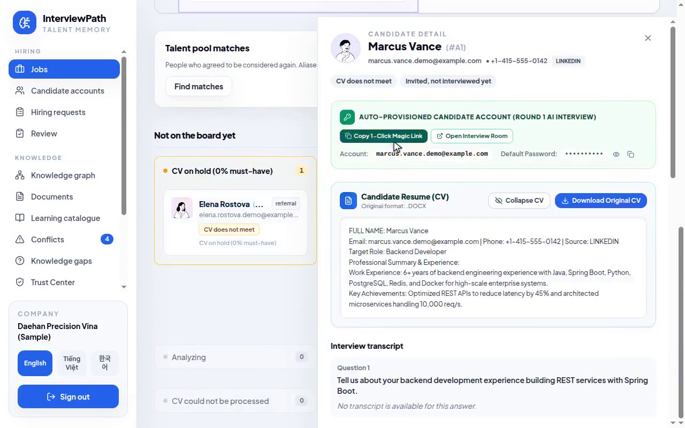
      <p align="center"><strong>4. Candidate Board & 1-Click Override</strong><br/><sub>Inspect parsed CVs, copy instant Magic Links, and invite held candidates into Round-1 spoken screening.</sub></p>
    </td>
  </tr>
  <tr>
    <td width="50%" valign="top">
      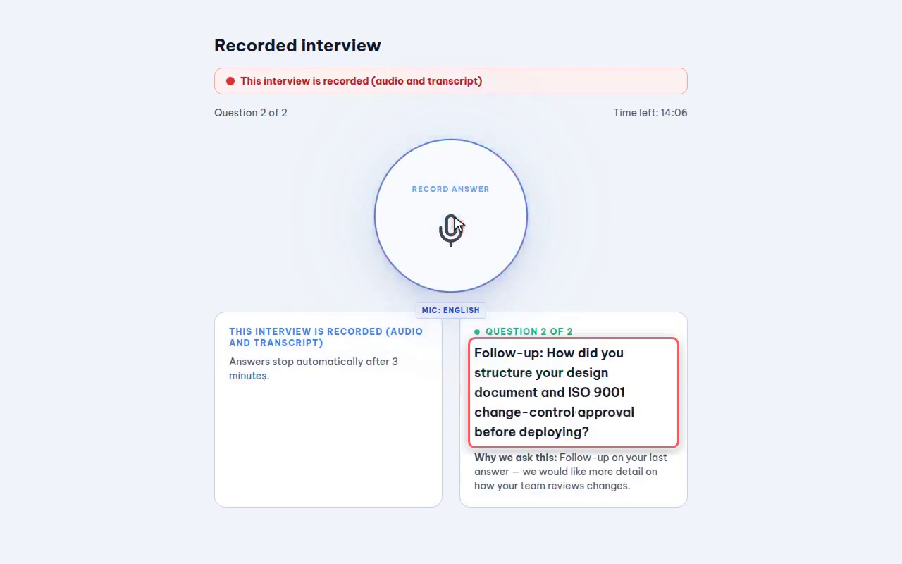
      <p align="center"><strong>5. Adaptive Spoken AI Interview Room</strong><br/><sub>Browser-recorded technical Q&A with adaptive follow-up questions on architecture and ISO change control.</sub></p>
    </td>
    <td width="50%" valign="top">
      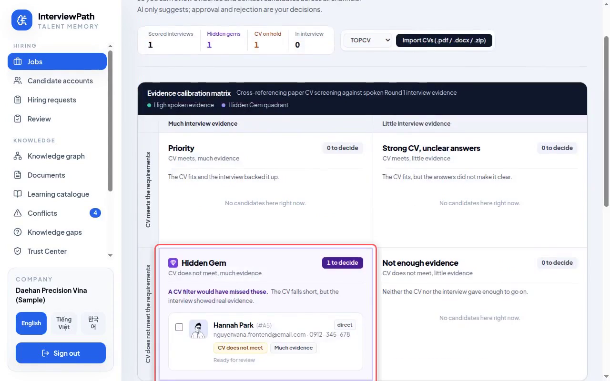
      <p align="center"><strong>6. 2×2 Evidence Calibration Matrix</strong><br/><sub>Cross-plots paper CV fit against spoken interview proof to spotlight high-signal Hidden Gems.</sub></p>
    </td>
  </tr>
  <tr>
    <td width="50%" valign="top">
      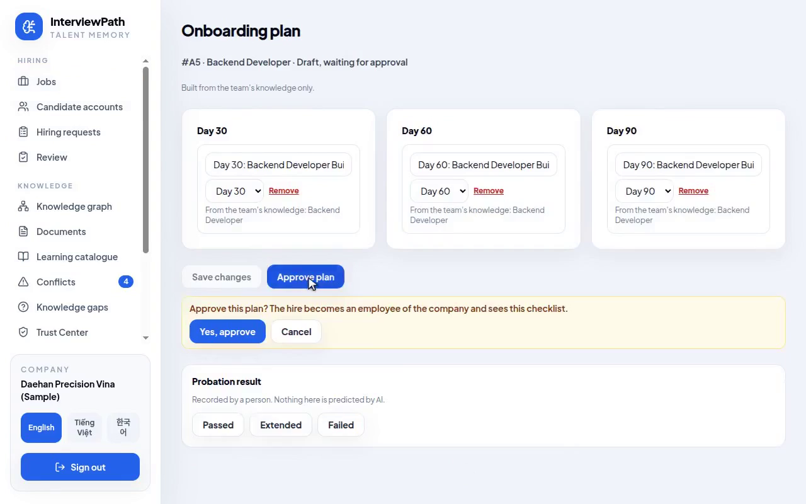
      <p align="center"><strong>7. 30-60-90 Day Probation Plan</strong><br/><sub>Auto-drafts role-specific Day 30 / 60 / 90 milestones from team knowledge nodes and interview gaps.</sub></p>
    </td>
    <td width="50%" valign="top">
      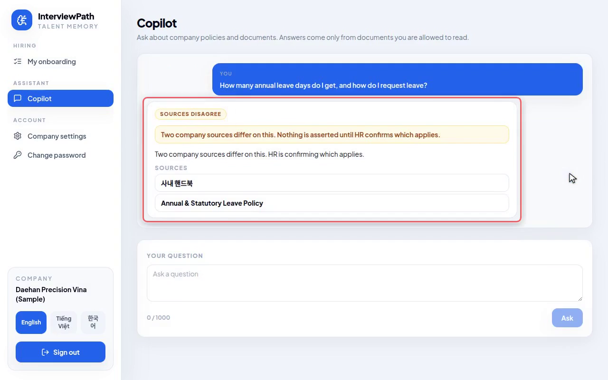
      <p align="center"><strong>8. Conflict-Aware Policy Copilot</strong><br/><sub>Answers employee questions with exact citations and flags <code>SOURCES DISAGREE</code> when handbooks conflict.</sub></p>
    </td>
  </tr>
</table>

---

## 🏗️ System Architecture

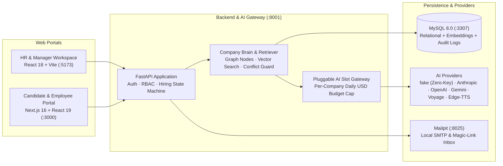

---

## 🚀 Quick Start (Docker)

InterviewPath ships with a deterministic **`fake` AI provider** enabled by default in [`.env.example`](./.env.example). You can boot the entire platform, seed two multi-document sample companies, and test every screen **with zero external API keys and $0 inference spend**.

### Prerequisites
- **Docker** & **Docker Compose v2**

### 1. Configure `.env`
```bash
cp .env.example .env
```

Set a URL-safe database password and JWT secret in `.env` (for quick local evaluation, run):
```bash
sed -i 's/^SECRET_KEY=$/SECRET_KEY=local-dev-secret-key-at-least-32-chars-long/' .env
sed -i 's/^MYSQL_ROOT_PASSWORD=$/MYSQL_ROOT_PASSWORD=localdevpass123/' .env
sed -i 's|^DATABASE_URL=$|DATABASE_URL=mysql+pymysql://root:localdevpass123@db:3306/speakcv|' .env
```

### 2. Start All Containers
```bash
make up
# or: docker compose --env-file .env up --build -d
```

### 3. Run Migrations & Seed Sample Companies
```bash
# Upgrade database schema
docker compose exec speakcv-backend python -m app.cli migrate

# Seed 'daehan-precision' & 'sori-labs' knowledge graphs with a known demo password
docker compose exec -e SAMPLE_USER_PASSWORD=DemoPass123! speakcv-backend \
  python -m app.cli seed-samples --auto-approve

# Populate realistic channel attribution & funnel data (240 simulated applications, 0 AI calls)
docker compose exec speakcv-backend \
  python -m app.cli simulate-hiring --company daehan-precision --seed 42
```

### 4. Open the Workspaces

| Service | Local URL | Sample Credentials (`SAMPLE_USER_PASSWORD=DemoPass123!`) |
| :--- | :--- | :--- |
| **HR & Manager Workspace** | `http://localhost:5173` | **HR:** `hr@daehan-precision.sample` / `DemoPass123!`<br/>**Manager:** `manager@daehan-precision.sample` / `DemoPass123!` |
| **Candidate & Employee Portal** | `http://localhost:3000` | **Employee (Copilot & Onboarding):** `employee@daehan-precision.sample` / `DemoPass123!`<br/>*(Or apply with any `.pdf`/`.docx` CV from `demo-cvs/` to receive a live candidate account)* |
| **FastAPI Interactive Docs** | `http://localhost:8001/docs` | OpenAPI / Swagger UI |
| **Mailpit (Local Email Inbox)** | `http://localhost:8025` | Captures outgoing candidate Magic Links & notifications locally |

> **Using Live AI Models (Optional):** Update `AI_REASONING_PROVIDER`, `AI_BULK_PROVIDER`, `AI_EMBEDDING_PROVIDER`, `AI_STT_PROVIDER`, and `AI_TTS_PROVIDER` in `.env` (`anthropic`, `openai`, `gemini`, `voyage`, `edge_tts`) along with the corresponding API key. Per-company daily spend is automatically guarded by `AI_COMPANY_DAILY_BUDGET_USD` (default `$25/day`).

---

## 🧪 Evaluation & Verification Suite

Beyond unit and browser end-to-end tests, the repository includes offline evaluation harnesses against labelled ground truth (planted policy contradictions, confidential canary strings, multilingual bias statements, and cross-company question specificity):

```bash
# Backend unit & integration tests
make test

# Ephemeral MySQL 8.0 container integration suite
make test-mysql

# Full hiring loop Playwright E2E test (Candidate Portal + HR Workspace + Backend)
make e2e

# Company Brain retrieval, citation & contradiction benchmark (prints cost estimate before running)
make eval-brain ARGS="--profile fake"

# Multilingual JD discrimination guard benchmark (EN / VI / KO)
make eval-discrimination ARGS="--profile fake"

# Cross-company interview question plan specificity benchmark
make eval-plan-overlap ARGS="--profile fake"
```

---

## 👥 Contributors

Built by **Team Zenith** — **HUTECH University** (Ho Chi Minh City University of Technology):

- **Lưu Gia Bảo**
- **Tạ Hoàng Thành**
- **Nguyễn Phương Quang**

---

## 📄 License

Distributed under the **MIT License**. Note that all company names (`Daehan Precision Vina (Sample)`, `Sori Labs (Sample)`), handbooks, and candidate profiles in `seed/` and `demo-cvs/` are fictional sample datasets created strictly for demonstration and benchmarking.
